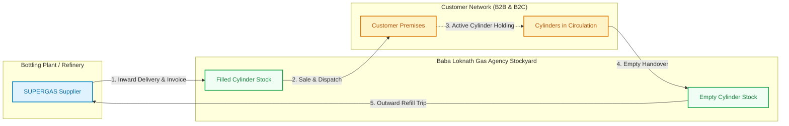
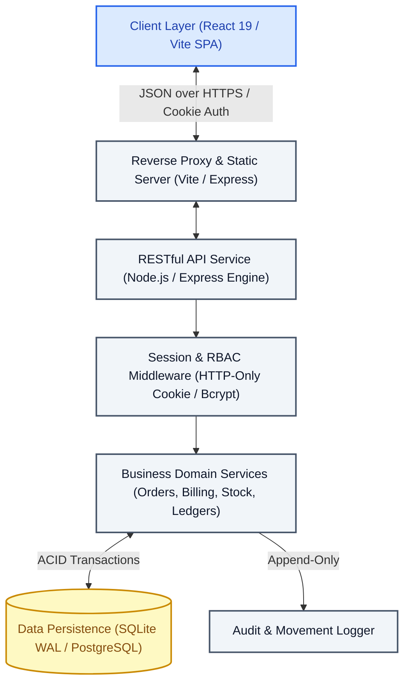
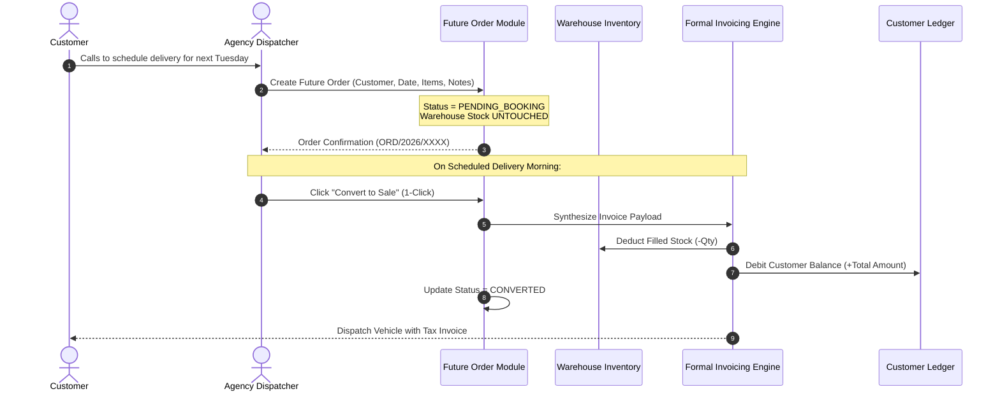
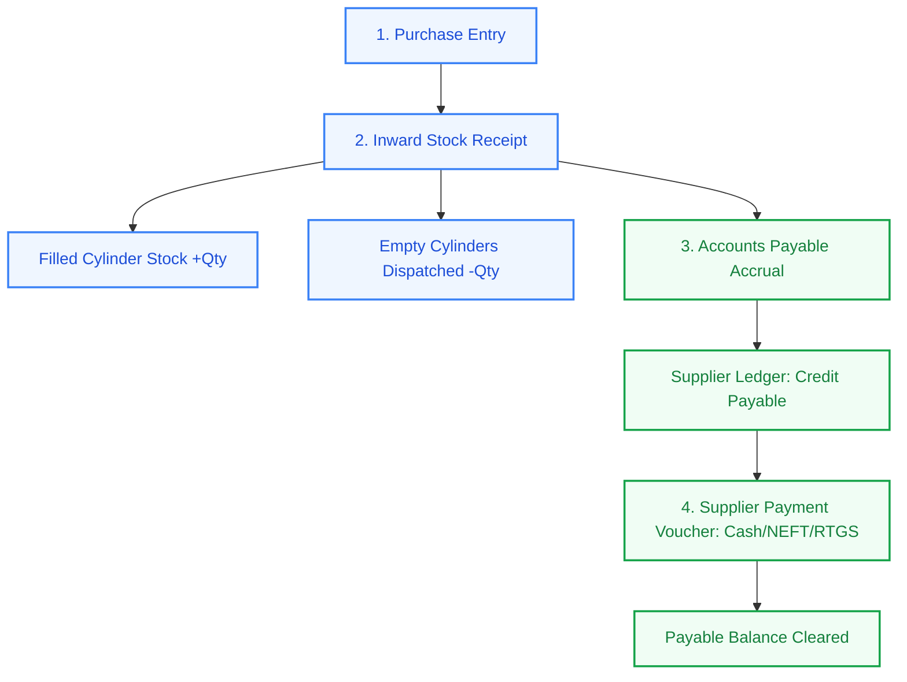
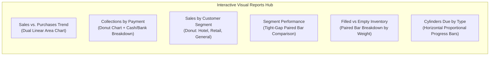

# GasFlow Enterprise ERP — Complete System Documentation
**Distribution & Cylinder Logistics Management System for Authorized SUPERGAS Distributors**  
*Document Version: 2.4.0 | Target Agency: Baba Loknath Gas Service | Production Release*

---

## Executive Summary

**GasFlow** is a purpose-engineered, mission-critical Enterprise Resource Planning (ERP) and distribution logistics platform designed specifically for LPG (Liquefied Petroleum Gas) cylinder distributors and bulk fuel agencies. 

Conventional generic ERP platforms fail gas distribution agencies because they treat inventory as static, consumable units. In the LPG industry, inventory follows a continuous, closed-loop bidirectional cycle: filled cylinders are sold, customer security balances are maintained, empty cylinders circulate as physical assets, and empty cylinders are returned to the refinery/bottling plant for refilling.

GasFlow bridges this operational gap by uniting **dual-stream stock tracking (Filled vs. Empty)**, **customer cylinder circulation dues**, **multi-tier GST billing (B2B Tax Invoices vs. B2C Retail Cash Memos)**, **Future Order Pre-Sales Cart**, **Supplier Payables**, and **Statutory GSTR-1/GSTR-2 Tax Export Engines** into a single, cohesive, sub-millisecond responsive application.



---

<div style="page-break-after: always;"></div>

# PAGE 1: System Architecture, Technology Stack & Security

### 1.1 Architectural Blueprint

GasFlow uses a decoupled client-server architecture engineered for offline resilience, high concurrency, and rapid localized execution at the distributorship site.



### 1.2 Technology Stack

| Architectural Tier | Technologies Deployed | Purpose & Implementation Details |
| :--- | :--- | :--- |
| **Frontend Framework** | **React 19, TypeScript, Vite 8** | Ultra-fast client-side routing, optimistic state mutations, reactive UI rendering. |
| **Component System** | **Tailwind CSS, Base UI, Lucide Icons** | Bespoke design system adhering to accessible WCAG AA standards, mobile-responsive layouts. |
| **Visualization** | **Recharts 2.x** | Custom responsive SVG charts (Grouped tight-gap bars, Dual-line trends, Centered Donut charts). |
| **Application Server** | **Node.js 22 LTS, Express 4** | High-throughput asynchronous REST API engine with transactional integrity wrappers. |
| **Database Engines** | **SQLite (WAL Mode) & PostgreSQL** | Dual-driver architecture: SQLite for low-overhead local branch operations; PostgreSQL for enterprise clustering. |
| **Excel Export Engine** | **SheetJS (xlsx)** | Native binary generation of GSTR-1 and GSTR-2 compliant multi-sheet spreadsheets. |
| **Security Layer** | **Bcrypt, HTTP-Only Cookies, Cryptographic UUIDv4** | Tamper-proof session management, zero client-accessible credentials, CSRF protection. |

### 1.3 Core Business Invariants

To guarantee that inventory numbers never drift from financial reality, GasFlow strictly enforces two non-negotiable system invariants:

1. **The Physical Stock Conservation Invariant**:
   $$\text{Total System Cylinders} = \text{Filled Stock} + \text{Empty Stock} + \text{Customer Dues} + \text{Supplier In-Refill}$$
   Every invoice decrementing filled stock must either increment customer due count or record an empty cylinder return in the exact same transaction.
2. **The Double-Entry Balance Invariant**:
   $$\Delta \text{Customer Balance} = \text{Invoice Total (Taxable + GST)} - \text{Payments Received} - \text{Discount Adjustments}$$
   No invoice, payment, or credit note can be created or updated without an atomic entry in `customer_ledger`.

### 1.4 Security & Access Control (RBAC)

The system features granular Role-Based Access Control dividing responsibilities between **Administrator (Owner)** and **Operator (Staff)**:

```
                    ┌───────────────────────────────┐
                    │       Authentication          │
                    │  (Bcrypt Hash / Cookie Token) │
                    └───────────────┬───────────────┘
                                    │
                    ┌───────────────┴───────────────┐
                    ▼                               ▼
       ┌────────────────────────┐      ┌────────────────────────┐
       │     Administrator      │      │    Staff / Operator    │
       ├────────────────────────┤      ├────────────────────────┤
       │ • Financial Dashboard  │      │ • Customer Lookup      │
       │ • Master Price Setup   │      │ • New Invoices / POS   │
       │ • Staff Payroll & Mgmt │      │ • Book Future Orders   │
       │ • Void/Cancel Invoices │      │ • Record Cash Inward   │
       │ • Direct Stock Adjust  │      │ • Cylinder Returns     │
       │ • CA Tax Excel Exports │      │ • Purchase Entry       │
       └────────────────────────┘      └────────────────────────┘
```

- **Session Hardening**: Browser sessions use 256-bit entropy random tokens stored in `httpOnly`, `sameSite=lax`, `secure` cookies.
- **Audit Logging**: All destructive operations (cancellations, credit overrides, price updates, and inventory reconciliations) are written to `audit_logs` with staff timestamp and IP address.

---

<div style="page-break-after: always;"></div>

# PAGE 2: Commercial Operations — Billing, Pre-Sales Cart & Logistics

### 2.1 The Sales & Billing Engine

GasFlow provides a streamlined Point-of-Sale (POS) invoicing interface optimized for high-volume counter sales and field delivery dispatch.

```
+---------------------------------------------------------------------------------------+
|  INVOICE CREATION WORKFLOW                                                            |
|                                                                                       |
|  [Select Customer] ----> [Add Products] ----> [Cylinder Return] ----> [Payment Entry] |
|   • B2B / B2C Auto        • Cylinder Type      • Match Qty or Dues   • Cash / UPI     |
|   • Credit Limit Check    • Loose Gas (Per KG) • Empty Stock +1      • Bank / Cheque  |
|   • Outstanding Alert     • 5% / 18% Auto GST  • Customer Due -1     • Ledger Updated |
+---------------------------------------------------------------------------------------+
```

#### Invoicing Features:
- **B2B vs. B2C Categorization**:
  - **B2B Customers**: Requires registered trade name, valid 15-digit GSTIN, and state code. Invoices produce formal Tax Invoices with itemized CGST/SGST breakdowns.
  - **B2C Retailers/Households**: Generates simplified retail cash memos with optional customer mobile number identification.
- **Dynamic Product Support**:
  - **Standard Cylinders**: 12 KG, 17 KG, 19 KG Commercial, 21 KG, 33 KG, and 47.5 KG Industrial cylinders.
  - **Loose Commercial LPG (by KG)**: Tailored for industrial vaporizers and customized decanting, priced accurately per kilogram.
  - **Non-Gas Merchandise**: Cooktops, CV Adapters, Low-Pressure Regulators, Leak Detectors, Delivery and Handling Charges.
- **Thermal & A4 Print Formats**: Instant 1-click printing supporting 80mm ESC/POS thermal receipt printers for drivers and standard A4 invoices for commercial clients.

### 2.2 Future Orders & Pre-Sales Cart (Advance Scheduling)

The **Future Orders** module operates as an advance booking cart. It allows dispatchers to record customer delivery commitments days in advance without distorting present warehouse stock.



#### Order Lifecycle States:
1. `PENDING`: Order recorded, delivery scheduled, driver instructions noted. Warehouse inventory remains unaltered.
2. `CONVERTED`: Transitioned via single-click into an active invoice. Deducts warehouse filled inventory and posts to the ledger.
3. `CANCELLED`: Voided by customer request. Preserves audit history with zero stock adjustments.

### 2.3 Cylinder Allocation & Due Tracking

GasFlow treats steel cylinders as circulating company capital. Every cylinder delivered must return to the warehouse.

- **Customer Due Ledger**: A live counter tracks every cylinder diameter/weight currently held by every customer.
- **Empty Return Modal**: During billing or via the standalone return terminal, staff record empty returns.
- **Deficit Alerts**: When a customer requests more cylinders than their authorized holding limit or exceeds 30-day return thresholds, the system flags the operator.

---

<div style="page-break-after: always;"></div>

# PAGE 3: Supply Chain, Accounting & Expense Management

### 3.1 Supplier Refill & Inward Purchasing

Procurement management tracks inward bulk loads and refills from the SUPERGAS terminal or regional bottling facility.



#### Inward Entry Capabilities:
- **Refill Tracking**: Matches empty cylinder handovers against filled cylinder receipts.
- **Freight & Handling Accounting**: Itemized entry for haulage costs, regulatory valve test charges, and replacement seal fees.
- **Payable Balances**: Real-time supplier ledger updating current payable balance, credit period countdown, and payment vouchers.

### 3.2 Dual-Entry Customer Ledger & Financials

Every rupee passing through the distributorship is strictly tracked against party ledgers.

```
+---------------------------------------------------------------------------------------------+
| PARTY LEDGER TRANSACTION STRUCTURE                                                          |
|                                                                                             |
| Date        | Transaction Ref | Type    | Description                | Debit (₹) | Credit (₹) | Balance (₹) |
|-------------|-----------------|---------|----------------------------|-----------|------------|-------------|
| 2026-11-20  | INV/2026/0112   | INVOICE | 10x 19kg Commercial LPG   | 26,000.00 |       0.00 |   26,000.00 |
| 2026-11-21  | PAY/2026/0084   | PAYMENT | UPI (Ref: 432890123)       |      0.00 |  15,000.00 |   11,000.00 |
| 2026-11-22  | RET/2026/0019   | RETURN  | 10x 19kg Empty Return (0₹) |      0.00 |       0.00 |   11,000.00 |
+---------------------------------------------------------------------------------------------+
```

- **Multi-Mode Receipt Capture**: Cash on Counter, UPI / QR Scan, Bank Transfer (IMPS / NEFT / RTGS), and Cheques with clearing status.
- **Real-Time Customer Balances**: Instantly visible in customer cards, preventing over-extension of unsecured credit.

### 3.3 Operating Expenses & Staff Payroll

Beyond gas procurement, GasFlow tracks the daily operational overhead required to run a distributorship:

- **Categorized Operational Vouchers**:
  - *Fleet & Delivery*: Fuel, vehicle servicing, tyre maintenance, driver allowances.
  - *Facility Overheads*: Warehouse rent, electrical utilities, safety audits, fire equipment testing.
  - *Office & Admin*: Stationery, internet, tea & staff refreshments.
- **Staff Payroll & Advances**:
  - Staff salary ledger maintaining base pay, monthly advances, deductions, and payment disbursement vouchers (`/api/staff/salaries`).

---

<div style="page-break-after: always;"></div>

# PAGE 4: Analytics, Modern Reporting & GST Compliance

### 4.1 Executive Business Dashboard

The GasFlow Dashboard presents leadership with an instantaneous pulse of company health:

```
+---------------------------------------------------------------------------------------------+
| [ Total Sales ]       [ Collections ]       [ Purchases ]           [ Receivables ]         |
|   ₹1,98,076.00          ₹1,24,111.00          ₹60,796.00              ₹75,174.00            |
|   ↗ 12.8% vs last pd    ↗ 8.2% vs last pd     ↗ 4.6% vs last pd       ↘ 3.1% less than prior|
+---------------------------------------------------------------------------------------------+
| [ Gas Sold (KG) ]     [ Gas Purchased ]     [ GST Collected ]                               |
|   5,240 KG              6,120 KG              ₹9,432.19                                     |
|   ↗ 14.1% volume surge  ↗ 5.3% intake         Across 12 Tax Invoices                        |
+---------------------------------------------------------------------------------------------+
```

### 4.2 Decision-Ready Business Intelligence Suite

The redesign of the Business Reports hub introduces high-density visual intelligence:



- **Tight-Gap Bar Rendering**: Paired bars in Segment Performance and Stock Availability feature an optimized 4px gap (`barGap={4}`, `barSize={22}`), sitting side-by-side without visual disconnection.
- **Smart Insight Banners**: Automated data-driven notes summarizing channel leaders (e.g. *"Cash is your most-used payment method (80.4%)"*, *"12 kg cylinders account for 70% of customer dues"*).

### 4.3 Statutory GST Compliance & Excel Export Suite

GasFlow automates the monthly preparation of GST filing data, transforming hours of manual bookkeeping into an instant download.

```
                          ┌───────────────────────────┐
                          │    GasFlow GST Engine     │
                          └─────────────┬─────────────┘
                                        │
                 ┌──────────────────────┴──────────────────────┐
                 ▼                                             ▼
   ┌───────────────────────────┐                 ┌───────────────────────────┐
   │    Outward Supply (Sales) │                 │   Inward Supply (Purchase)│
   │       GSTR-1 Excel (.xlsx)│                 │       GSTR-2 Excel (.xlsx)│
   ├───────────────────────────┤                 ├───────────────────────────┤
   │ • Invoice No & Date       │                 │ • Supplier GSTIN & Name   │
   │ • Customer GSTIN & State  │                 │ • Purchase Bill No & Date │
   │ • HSN 27111900 Gas Codes  │                 │ • Taxable Inward Value    │
   │ • Taxable Value           │                 │ • Input Tax Credit (ITC)  │
   │ • CGST, SGST, IGST        │                 │ • Cylinder & KG Breakdown │
   └───────────────────────────┘                 └───────────────────────────┘
```

The system produces native `.xlsx` files pre-formatted for direct handoff to Chartered Accountants (CAs) and GST portal offline tools.

---

<div style="page-break-after: always;"></div>

# PAGE 5: Administration, Installation Runbook & API Reference

### 5.1 Installation & Server Deployment Runbook

#### Prerequisites
- **Node.js**: `v22.0.0` or higher
- **Package Manager**: `npm v10+`
- **Database**: SQLite 3 (included) or PostgreSQL 15+

#### Step-by-Step Installation
```bash
# 1. Clone repository and navigate to application root
git clone https://github.com/sourav03561/SuperGas-.git
cd SuperGas-/gasflow-app

# 2. Configure environment credentials
cp .env.example .env.local

# 3. Install dependencies
npm install

# 4. Execute database schema migrations
npm run db:migrate

# 5. Initialize seed data (Admin credentials & SuperGas cylinder catalog)
npm run db:seed-admin
npm run db:seed-products

# 6. Build production client and start server
npm run build
npm start
# Server listens on http://127.0.0.1:4000 (Production) or http://127.0.0.1:3000 (Dev)
```

### 5.2 Environment Variables Reference (`.env.local`)

| Variable Key | Required | Default Value | Description |
| :--- | :--- | :--- | :--- |
| `PORT` | Optional | `4000` | Port for the backend API and Express production server. |
| `NODE_ENV` | Yes | `production` | Environment mode (`development` or `production`). |
| `DATABASE_URL` | Optional | `sqlite:./data/gasflow.db` | PostgreSQL connection string or SQLite path. |
| `SESSION_SECRET` | Yes | `[cryptographic-hex-string]` | Key used to sign session cookies. |
| `ADMIN_EMAIL` | Yes | `admin@babaloknathgas.com` | Root system administrator username. |
| `ADMIN_PASSWORD` | Yes | `[initial-admin-password]` | Seed password for initial administrative setup. |

### 5.3 Core REST API Directory

| Domain | Method | Endpoint Route | Request Body / Query | Description |
| :--- | :--- | :--- | :--- | :--- |
| **Auth** | `POST` | `/api/auth/login` | `{ email, password }` | Authenticates staff and sets HTTP-only cookie. |
| **Customers** | `GET` | `/api/customers` | `?search=xyz&type=B2B` | Returns customer list with active cylinder dues. |
| **Customers** | `POST` | `/api/customers` | `{ name, phone, gstin, type }` | Creates new customer record with credit limits. |
| **Orders** | `GET` | `/api/orders` | `?status=PENDING` | Retrieves future advance booking orders. |
| **Orders** | `POST` | `/api/orders` | `{ customerId, deliveryDate, items }` | Schedules future order into advance pre-sales cart. |
| **Orders** | `POST` | `/api/orders/:id/convert` | `{ paymentMethod, amountPaid }` | Converts future order into formal invoice & deducts stock. |
| **Invoices** | `POST` | `/api/invoices` | `{ customerId, items, returnItems }` | Generates tax invoice, updates stock and cylinder dues. |
| **Purchases** | `POST` | `/api/purchases` | `{ supplierId, invoiceNo, items }` | Inwards filled stock and offsets empty return counts. |
| **Suppliers** | `GET` | `/api/suppliers` | — | Lists suppliers, payable balances, and terms. |
| **Reports** | `GET` | `/api/reports/business` | `?from=YYYY-MM-DD&to=YYYY-MM-DD` | Aggregates all KPI metrics, segment data, and charts. |
| **Reports** | `GET` | `/api/reports/gst-bills/export` | `?month=11&year=2026` | Streams binary Excel (.xlsx) GSTR-1 outward tax report. |
| **Reports** | `GET` | `/api/reports/gas-purchases/excel`| `?month=11&year=2026` | Streams binary Excel (.xlsx) GSTR-2 inward purchase report. |

### 5.4 Backup & Maintenance Runbook

- **Automated Database Backups**:  
  For SQLite deployments, run a nightly copy while in WAL mode:
  ```bash
  sqlite3 data/gasflow.db ".backup 'data/backups/gasflow_$(date +%Y%m%d).db'"
  ```
- **Integrity Check Command**:
  ```bash
  npm run test:transactions
  ```
  Runs atomic transaction rollbacks against an isolated test database to verify database triggers and invariant integrity.

---
*End of Documentation — GasFlow Enterprise ERP v2.4.0 (SUPERGAS Distributor Edition)*
